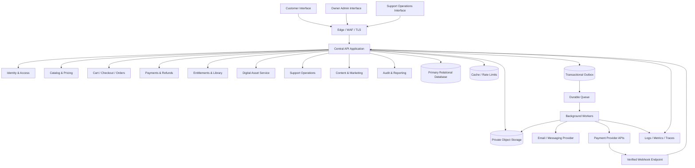

# Backend 01 — System Architecture and Module Boundaries

## 1. Logical topology

This is a logical view. The repository audit decides how it maps to existing processes, packages and deployment units.

## 2. Deployment recommendation

Deploy three independently routable frontend surfaces and one shared API service. The API and worker may be separate processes from one codebase. The primary DB and private object storage are managed infrastructure dependencies. Do not create independent customer/admin/support backend codebases.

Logical origins/domains are configuration decisions. Cookies, CORS, CSRF, callback URLs and OAuth redirects must be designed for the selected deployment topology before authentication is released.

## 3. Domain modules and responsibilities

| Module | Owns | Must not own |
|---|---|---|
| Identity & Access | Accounts, credentials, sessions, MFA, roles, permissions | Customer commerce state |
| Customer Profile | Customer-visible profile/preferences/consents | Authentication secrets |
| Catalog | Ebook metadata, authors, categories, collections, publication status | Payment settlement |
| Digital Assets | File metadata, upload sessions, validation, versions, storage references | Product pricing or order state |
| Pricing & Promotions | Price rules, coupon validation, eligibility, discount calculation | Payment gateway capture |
| Cart & Checkout | Cart state, checkout snapshot, tax/discount quote, order creation | Provider settlement truth |
| Orders | Order and line snapshots, order lifecycle | Ebook object storage |
| Payments | Payment attempts, provider references, webhook events, reconciliation | Customer-facing UI decisions |
| Refunds | Refund requests, approval, provider submission and outcomes | Arbitrary order deletion |
| Entitlements | Buyer rights to access a specific digital product/version | Public product listing |
| Reader & Downloads | Authorized read/download sessions, progress, bookmarks and access logs | Payment verification |
| Support | Tickets, messages, assignments, notes and permitted investigations | Broad finance configuration |
| CMS & Marketing | Pages, banners, collections, campaign content and coupon administration | Core payment state |
| Notifications | Templates, preferences, delivery attempts and provider adapters | Source-of-truth business state |
| Analytics | Aggregations and reporting projections | Authoritative order/payment writes |
| Audit | Append-only security/business audit trail | Mutable application state |
| Configuration | Non-secret store settings and feature flags | Secret storage itself |

Each module exposes application/service interfaces. Other modules must not reach into its private tables or bypass its invariants. Shared database transactions are allowed where required by a modular monolith, but ownership and transaction boundaries must be explicit.

## 4. Cross-panel request model

- Customer operations use customer-scoped policies and the authenticated principal's own resources.
- Owner/Admin operations require an explicit permission and, for sensitive actions, step-up authentication and an audit reason.
- Support operations require support-specific permissions and a recorded access reason for sensitive customer/order investigations.
- Public catalog endpoints expose only fields intentionally approved for public display.
- Panel visibility is a frontend concern; security is enforced by API policy and domain services.

## 5. Transactional boundaries

The following must be atomic inside the primary DB wherever feasible:

- Create order + order item snapshots + checkout reference + outbox event.
- Persist a verified payment event + update payment attempt/transaction state + enqueue resulting domain event.
- Approve refund + persist refund request state + enqueue provider submission command.
- Grant entitlement + persist access grant + enqueue customer notification.
- Change staff role/permission + persist audit event.

External provider calls must not be made while holding a long database transaction. Use an explicit pending state, durable job/outbox command, then persist the provider result.

## 6. Synchronous vs asynchronous work

**Synchronous:** authorization, input validation, catalog reads, cart validation, creation of checkout/order records, staff permission checks and lightweight status reads.

**Asynchronous:** email, large file scanning/conversion, cover processing, analytics aggregation, provider reconciliation, bulk imports/exports, queued refund submission, scheduled campaigns and notification delivery.

The API must return a durable resource/state when an asynchronous operation is accepted. Never return a success response for an external action that has not succeeded; distinguish `accepted`, `pending`, `succeeded` and `failed`.

## 7. Integration adapters

Build provider-neutral interfaces for:

- Payment gateway (create/confirm/capture/refund/query/reconcile/webhook verification).
- Email and optional messaging (send template, delivery webhook, suppression/bounce handling).
- Object storage (private upload, head/stat, version, read grant, delete/retention).
- Malware scanning/file inspection.
- Search indexing (optional adapter; DB search can serve initial needs).
- Analytics export (if a separate provider is selected).

Provider adapters must translate provider-specific states into canonical internal states. Do not leak provider-specific payloads into business rules.

## 8. Data ownership and consistency

The primary relational database is the source of truth for users, catalog metadata, prices, carts, orders, payment records, refunds, entitlements, support and settings. Object storage is the source of truth for file bytes; the DB stores object keys, versions, checksums and access metadata. Cache and search indexes are disposable projections and must be rebuildable.

## 9. Extensibility without premature marketplace design

Do not add `seller_id`, vendor payouts, author wallets or multi-tenant isolation to the initial schema unless the owner approves a marketplace. The initial author record describes book authorship, not a platform seller. Keep module boundaries clean so marketplace expansion can be a future ADR and migration.
