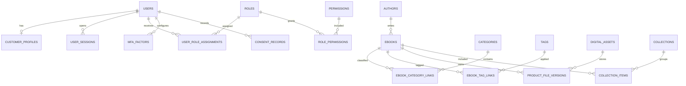
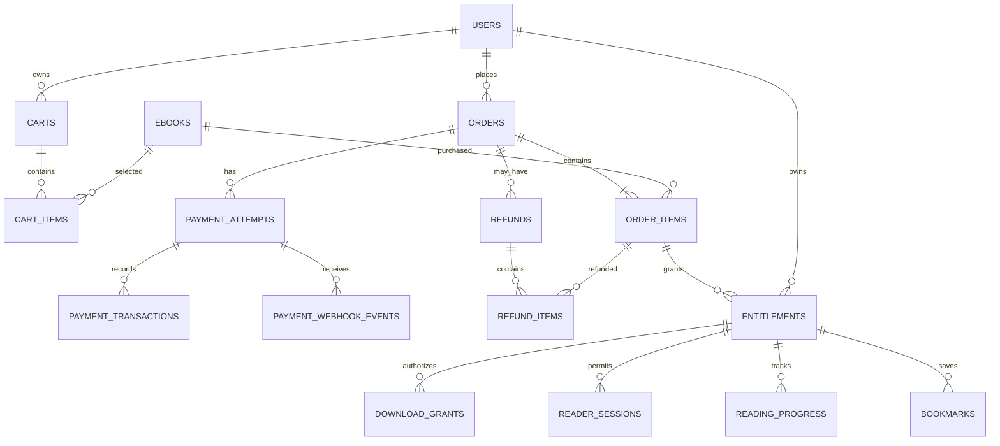
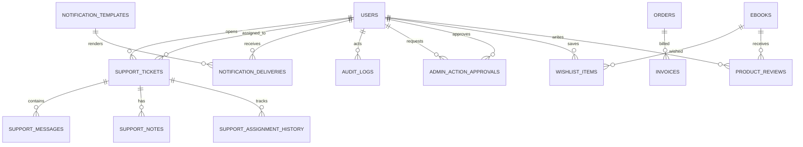

# Backend 02 — Data Model and Entity Relationship Design

**Important:** This is the canonical logical data model for review. The repository audit must map it to existing migrations and the chosen DB. Exact SQL types, constraints, names and migrations are specified in `03-DATABASE-SCHEMA-AND-INVARIANTS.md`. Do not create duplicate tables just because names differ in the existing repository; reconcile the concepts first.

## 1. Modeling conventions

- Use stable primary keys (UUIDv7/ULID or an existing approved equivalent).
- Every business table has `created_at` and `updated_at` in UTC unless an immutable event/ledger table has a different convention.
- Use explicit status columns backed by constrained values/enums or reference tables.
- Use integer minor currency units plus ISO currency code; never floating-point money.
- Store timestamps in UTC; store the business timezone as configuration and convert only at boundaries.
- Store original ebook bytes in private object storage, not in relational DB blobs.
- Store file metadata, checksum and storage object version in the DB.
- Prefer restrictive foreign keys and explicit archive/revocation states over cascading destructive deletes.
- Preserve immutable purchase snapshots and audit records.
- Do not add multi-tenant or vendor fields without an approved business-model decision.

## 2. Logical ERD — identity, catalog and digital files

## 3. Logical ERD — cart, checkout, payments and entitlements

## 4. Logical ERD — support, communications and platform control

## 5. Entity catalogue

### 5.1 Identity and access

| Entity | Purpose | Key relationships |
|---|---|---|
| `users` | Canonical human account identity and lifecycle | customer profile, sessions, roles, audit |
| `customer_profiles` | Customer-facing profile fields | one-to-one with user |
| `user_sessions` | Revocable server-side browser sessions | user |
| `password_credentials` | Password hash and credential metadata | user |
| `email_verification_tokens` | One-time email verification tokens (store hashes) | user |
| `password_reset_tokens` | One-time recovery tokens (store hashes) | user |
| `mfa_factors` | Authenticator registrations and status | user |
| `roles` | Role definitions (owner, finance, catalog, support, analyst, etc.) | role permissions, assignments |
| `permissions` | Atomic action permissions | roles |
| `role_permissions` | Role-to-permission mapping | role, permission |
| `user_role_assignments` | Role assignment and scope | user, role, assigning user |
| `consent_records` | Versioned consent/communication preferences | user |

### 5.2 Catalog and digital files

| Entity | Purpose | Key relationships |
|---|---|---|
| `authors` | Public author metadata; not a seller account | ebooks |
| `ebooks` | Product identity and public catalog metadata | author, category links, files, prices, reviews |
| `categories` | Hierarchical book classification | parent category, ebooks |
| `ebook_category_links` | Many-to-many product/category mapping | ebook, category |
| `tags` / `ebook_tag_links` | Search/discovery metadata | ebooks |
| `collections` | Curated/automatic groups | collection items |
| `collection_items` | Ordered ebook membership | collection, ebook |
| `digital_assets` | Uploaded file metadata and quarantine/scan state | file versions |
| `product_file_versions` | Versioned file assignment (main ebook, preview, cover, sample) | ebook, digital asset |
| `ebook_publication_history` | Publish/unpublish transitions and actors | ebook, actor |

### 5.3 Pricing, cart and commerce

| Entity | Purpose | Key relationships |
|---|---|---|
| `product_prices` | Current or scheduled catalog price by currency/time | ebook |
| `coupons` | Coupon definition, dates, limits and state | redemptions |
| `coupon_redemptions` | Customer/order usage records | coupon, user, order |
| `carts` | Active/expired cart state | user or approved guest identifier |
| `cart_items` | Ebook selection and quantity | cart, ebook |
| `checkout_sessions` | Time-bounded checkout/quote and idempotency state | cart, eventual order |
| `orders` | Canonical purchase aggregate and totals snapshot | customer, items, payment attempts, refunds |
| `order_items` | Immutable line-level purchase snapshot | order, ebook, entitlement |
| `order_status_history` | Append-only order transitions | order, actor/source |
| `tax_quote_snapshots` | Tax calculation evidence at checkout | checkout/order |
| `invoices` | Issued invoice/credit-note metadata and sequence | order |

### 5.4 Payment and refund

| Entity | Purpose | Key relationships |
|---|---|---|
| `payment_attempts` | Attempts to collect an order amount | order, provider |
| `payment_transactions` | Immutable captured/authorized/failed/refund transaction facts | payment attempt |
| `payment_webhook_events` | Raw/minimized verified provider event envelope and processing state | payment attempt/transaction |
| `refunds` | Requested/approved/submitted refund aggregate | order, payment transaction |
| `refund_items` | Refund allocation to order lines/amounts | refund, order item |
| `financial_ledger_entries` | Immutable financial event journal (not a substitute for statutory books) | order, payment, refund |
| `settlement_batches` | Optional provider settlement/reconciliation imports | transactions |
| `reconciliation_items` | Match/mismatch records from provider statements | transaction/settlement |

### 5.5 Entitlement, reading and downloads

| Entity | Purpose | Key relationships |
|---|---|---|
| `entitlements` | Customer's rights to a purchased ebook/version | user, order item, ebook |
| `entitlement_history` | Grant/suspend/revoke/restore transitions | entitlement, actor/reason |
| `download_grants` | Short-lived scoped download authorization metadata | entitlement |
| `download_events` | Download attempt/outcome audit metadata | entitlement, asset version |
| `reader_sessions` | Authorized online reader session metadata | entitlement |
| `reading_progress` | Latest position per user/entitlement/device strategy | entitlement |
| `bookmarks` | Saved reading locations | entitlement |
| `reading_notes` | Optional private notes; exclude from v1 unless owner approves | entitlement |

### 5.6 Support, content, notifications and audit

| Entity | Purpose |
|---|---|
| `support_tickets` | Customer service issue aggregate |
| `support_messages` | Customer/staff messages visible to participants |
| `support_internal_notes` | Private staff-only notes; never returned to customer APIs |
| `support_assignments` | Current/historical staff assignment |
| `support_attachments` | Ticket attachment metadata and private object keys |
| `cms_pages` | Static/policy/help content with revisions |
| `cms_page_revisions` | Versioned content changes |
| `homepage_sections` | Ordered storefront content blocks/configuration |
| `banners` | Campaign/banner content and scheduling |
| `notification_templates` | Versioned transactional templates |
| `notification_deliveries` | Send state, provider reference, retries and failures |
| `notification_preferences` | Customer-controlled communication settings |
| `audit_logs` | Append-only sensitive-action trail |
| `admin_action_approvals` | Optional maker-checker approvals for sensitive actions |
| `idempotency_records` | Durable request idempotency keys and results |
| `outbox_events` | Events committed atomically with domain changes |
| `inbox_events` | Processed external/internal message de-duplication |
| `job_execution_records` | Background job status and retries |
| `system_settings` | Non-secret typed configuration |
| `feature_flags` | Controlled feature rollout |

## 6. Important relationship rules

- A user may be both a customer and a staff member only if the owner approves that account policy. Staff roles must never be inferred from email domain or self-selected profile fields.
- An `author` is a book-credit profile, not an authenticated seller.
- An order has one or more immutable order items. A digital ebook item has no shipping address or physical inventory reservation.
- A payment attempt belongs to one order. An order may have multiple attempts, but only valid captured payments count toward settled order value.
- A refund references a captured payment and allocates the refunded amount. Refund totals cannot exceed refundable captured value, accounting for prior refunds and currency precision.
- An entitlement is granted from a valid paid order item (or another explicitly approved grant reason such as admin comp). It is not created by a frontend callback.
- An entitlement can have multiple file versions over time only under an approved version-access policy.
- Support notes are separate from customer-visible messages.
- Audit logs and financial transaction facts are append-only; corrections create new records.

## 7. Personal data classification

Classify fields before implementation:

- Public: ebook title, cover, author bio, public category descriptions.
- Internal: order IDs, operational statuses, non-sensitive support metadata.
- Personal: name, email, customer support content, IP/device context, reading activity.
- Sensitive operational: credential hashes, session IDs, MFA secrets, provider webhook signatures, access grants, gateway references.
- Secret: API keys, encryption keys, webhook secrets, storage credentials — never store plaintext in application tables or logs.

Each personal/sensitive field needs a purpose, access policy, retention rule and export/deletion handling.
