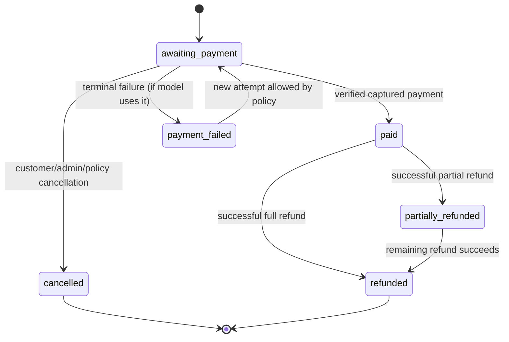
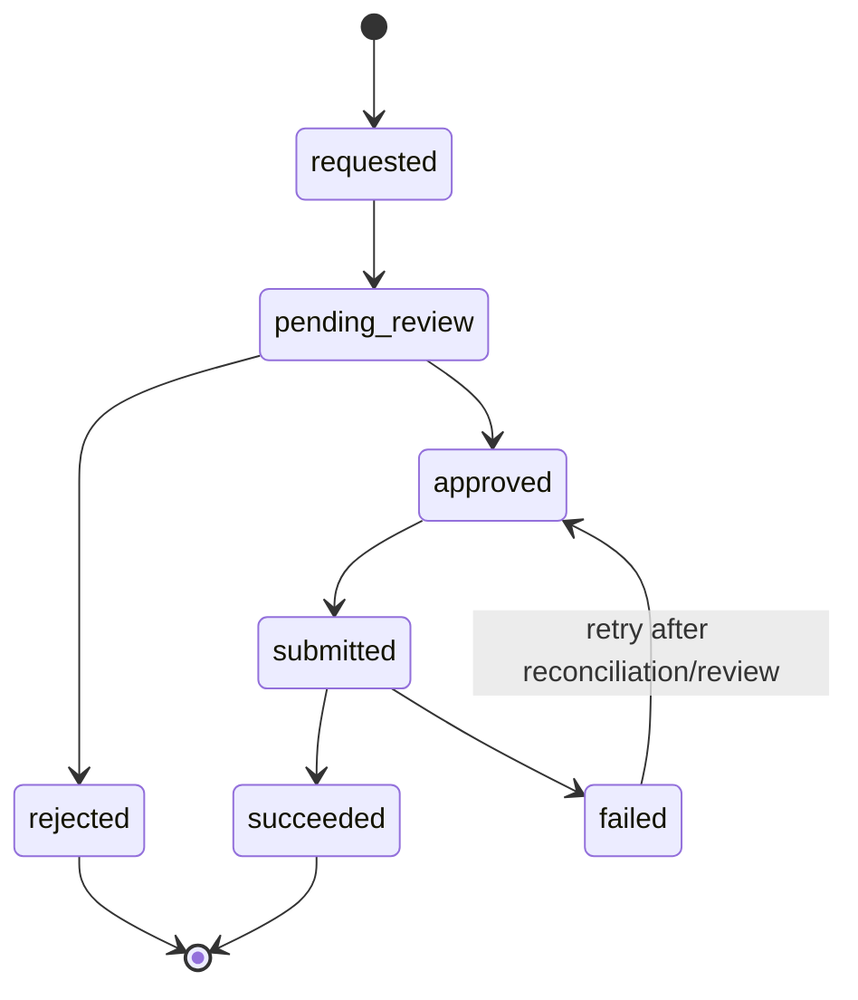
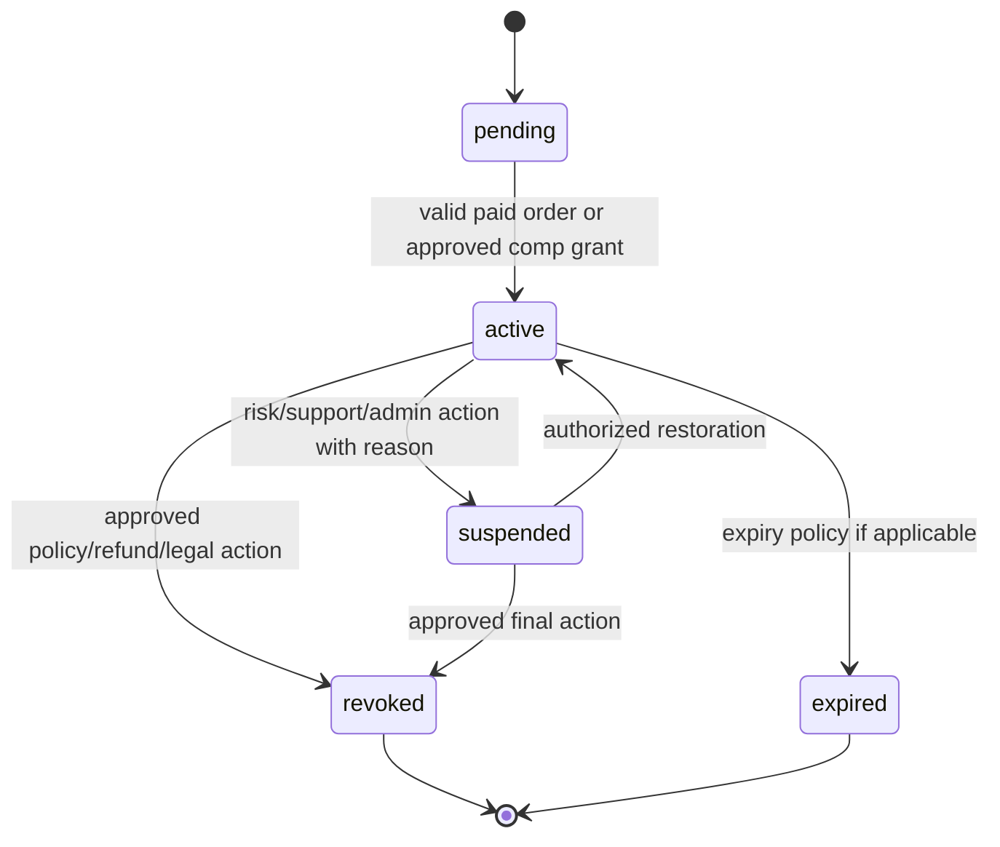

# Backend 06 — Commerce Workflows and State Machines

## 1. Core separation of concepts

Do not collapse cart, checkout, order, payment and entitlement into one `status` field. They are separate aggregates with independent lifecycles.

- **Cart:** mutable user selection.
- **Checkout session:** validated quote and payment handoff window.
- **Order:** commercial agreement/snapshot of what was purchased and for how much.
- **Payment attempt/transaction:** interaction with payment provider.
- **Refund:** a separate financial action against captured value.
- **Entitlement:** customer right to access a digital product.

## 2. Customer purchase flow

```mermaid
sequenceDiagram
  participant C as Customer Panel
  participant API as Backend API
  participant DB as Primary DB
  participant PG as Payment Provider
  participant W as Worker
  participant L as Customer Library
  C->>API: Add ebook to cart
  API->>DB: Validate product and save cart
  C->>API: Create checkout (Idempotency-Key)
  API->>DB: Recheck price/coupon/tax/status; snapshot order
  API-->>C: Checkout session + safe payment action
  C->>PG: Complete provider checkout
  PG->>API: Signed webhook
  API->>API: Verify signature and replay controls
  API->>DB: Persist unique event + payment state + outbox
  API-->>PG: Acknowledge verified event
  W->>DB: Consume outbox idempotently
  W->>DB: Mark order paid; grant entitlement atomically
  W->>L: Library now reflects entitlement
  W->>W: Send receipt/access notification
  C->>API: Refresh order/library
  API-->>C: Authoritative paid/order/entitlement state
```

The browser return route may query order/payment status, but must not mark an order paid or grant access.

## 3. Order state machine



Use exactly the order status model selected for the implementation. Do not mix transient payment-provider states into the order state. A failed payment attempt does not necessarily mean the entire order is permanently `payment_failed`; a retry may be allowed until checkout expiry.

Rules:

- An order becomes paid only after verified capture/settlement according to the chosen gateway contract.
- A payment authorization without capture is not automatically a paid order unless the product/payment policy explicitly uses authorization as fulfilment proof and the risk has been approved.
- A cancelled order cannot be paid by a late webhook without a defined late-payment compensation process.
- Refund completion changes order aggregate status only after verified provider outcome.
- Never delete an order to represent cancellation or refund.

## 4. Payment attempt state (canonical, provider-neutral)

Suggested states: `created`, `requires_customer_action`, `pending`, `authorized`, `captured`, `failed`, `cancelled`, `expired`, `partially_refunded`, `refunded`, `disputed`, `chargeback`.

Provider-specific states map to canonical states in the adapter. Store the provider raw status as minimized audit metadata, not as the only business state.

## 5. Refund state machine



A refund can be initiated by a customer request, support request or authorized admin. The actor who requests need not be the actor who approves/executes if maker-checker controls are enabled. A gateway submission is not a successful refund; only provider confirmation or reconciliation establishes success.

## 6. Entitlement state machine



Entitlements are independent from file download count and reader sessions. A single entitlement may authorize several permitted reading/download interactions under the approved policy. Each access attempt must check current entitlement state.

## 7. Customer access workflow

1. Customer authenticates or completes approved guest claim.
2. Backend loads their own entitlement list.
3. Product/version availability and entitlement state are checked.
4. Reader session or download grant is created with explicit scope and expiry.
5. Access event is recorded with minimal metadata.
6. Session expiry or entitlement revocation prevents future access.

Do not embed a permanent storage URL in the order, confirmation email or customer profile.

## 8. Support ticket state machine

Suggested states: `new`, `open`, `pending_customer`, `pending_internal`, `resolved`, `closed`, `reopened`.

Transitions require policy and actor validation. A customer reply may reopen a resolved ticket according to policy. A support agent cannot mark a refund successful merely by resolving a ticket. Ticket status and refund status remain separate.

## 9. Ebook publication state machine

Suggested states: `draft`, `processing_assets`, `ready_for_review`, `scheduled`, `published`, `unpublished`, `archived`.

A book may be published only when required metadata, price, current file, scan/validation and legal-rights attestations are complete. Exact review/approval workflow is an open decision. Publishing changes public visibility; it must not silently remove prior purchasers' entitlements.

## 10. Coupon and promotion lifecycle

Suggested states: `draft`, `scheduled`, `active`, `paused`, `expired`, `archived`. Validate dates, usage counts, per-customer limits, min/max cart amount, included/excluded products and stacking policy in one server-side pricing engine. Never trust a discount amount sent by the browser.

## 11. Concurrency and race handling

- Two concurrent checkout requests with the same idempotency key return the same logical result.
- Concurrent use of a single-use coupon cannot exceed its configured redemption limit; reserve/redeem using transactional locking or atomic constraints.
- Two webhook deliveries for one provider event result in one financial business effect.
- Refund requests are serialized or guarded so their combined amount cannot exceed remaining refundable balance.
- Entitlement creation is protected by a unique order-item/grant source constraint.
- Catalog price/status changes are rechecked at checkout and snapshot time.
- Concurrent edits to CMS/catalog/support use optimistic locking or version conflict responses where needed.

## 12. Audit requirements

Record actor/source, entity type/ID, previous and next status, reason code, request/correlation ID, event/provider reference and timestamps for material transitions. Do not log full sensitive payloads.
