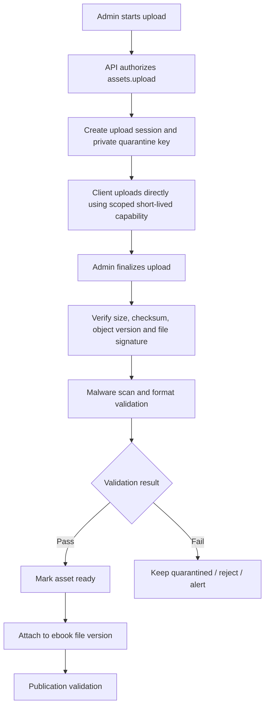

# Backend 08 — Digital Assets, Entitlements, Reader and Downloads

## 1. Scope and terminology

- **Digital asset:** physical file bytes in private object storage.
- **Product file version:** the catalog assignment of an asset to an ebook and purpose/format.
- **Entitlement:** an account's right to access a purchased/comped ebook.
- **Download grant:** short-lived authorization for a specific asset/version and operation.
- **Reader session:** short-lived authorization to load a supported format through a reader.

Do not equate a successful payment, a file URL and an entitlement. They are separate records and authorization checks.

## 2. Upload and ingestion pipeline

### Required controls

- Authenticate and authorize the uploader.
- Create a one-purpose upload session bound to asset type, allowed size, allowed format and intended product.
- Use a short-lived upload URL/token with restricted object key and operation; never provide bucket-wide credentials.
- Store to a private quarantine area, not public website path.
- Enforce maximum file size, extension allowlist, detected MIME/file signature and actual content format.
- Compute checksum (e.g. SHA-256) and record size/version.
- Scan for malware and malformed/unsafe documents.
- For EPUB, inspect archive structure and enforce limits against ZIP bombs, path traversal, oversized entries, external resource loading and malformed package documents.
- Reject executable/unsupported content and dangerous embedded content where relevant.
- Sanitize filenames and metadata; never trust user-supplied content type.
- Record scan result, scanner version and timestamp.
- Keep failed or incomplete assets quarantined and inaccessible.
- Make upload finalization idempotent.

## 3. Asset publication validation

An ebook cannot become public until the configured required fields and current main asset pass validation. Check:

- File belongs to the intended product.
- Detected format matches declared format.
- Malware scan passed and policy version is current.
- Size and structure limits passed.
- File version is complete and storage object is present.
- Preview/cover associations are valid.
- Pricing and required metadata exist.
- Rights/ownership attestation and content policies have been completed through the approved workflow.

## 4. Private storage and delivery

- Original files must be stored in a private bucket/container with public access blocked.
- Separate public cover/preview assets from purchased source files. Only the former may be delivered through public CDN paths after review.
- Do not expose raw object keys, permanent URLs, storage credentials or predictable object paths in public APIs.
- Check entitlement, status, allowed format, product version policy and customer identity before each download/reader grant.
- Use short-lived, narrowly scoped signed URLs or a controlled streaming/proxy service, based on threat/performance evaluation.
- Signed URL expiry should be short enough to limit leakage but long enough to complete realistic downloads; define and load-test the value.
- Log grants and outcomes without logging the full signed URL/token.
- Apply per-account, per-entitlement and risk-based rate limits; avoid arbitrary limits before owner policy is approved.
- Revoke future grant issuance immediately after entitlement suspension/revocation. Existing signed URL revocation limits depend on delivery architecture; choose and document acceptable exposure window.

## 5. Entitlement grant rules

Purchase grants:

- Grant only after verified paid order state or other explicit approved grant reason.
- Use a unique constraint on source order item/grant event to prevent duplicates.
- Grant in the same transaction that applies the canonical paid state when feasible.
- Store who/what granted it, source, timestamp and policy/version reference.

Administrative comp grants:

- Require `entitlements.grant_comp` permission, reason, target user/product and audit record.
- Optional expiry/conditions must be explicit.
- Must not masquerade as a purchase or financial transaction.

Suspension/revocation:

- Require permission and reason.
- Preserve history and order/payment facts.
- Enforce future access checks.
- Refund-related revocation behaviour is blocked by owner decision D-012.

## 6. File versioning policy

Do not overwrite a purchased ebook's storage object in place. Create a new immutable asset/version and update the product's current version pointer.

The owner must approve whether prior buyers receive:

- access to the version they purchased;
- automatic migration to the latest version;
- latest version plus a recorded version history;
- notification when a material version changes.

Until approved, retain version references and do not delete a previously entitled version automatically.

## 7. Reader architecture

Reader engine must be selected through a technical evaluation, not by convenience alone. Compare candidate implementations for:

- EPUB 3.3 and backward-compatible EPUB 3 support as required;
- PDF support, page navigation and text selection;
- accessibility and assistive technology;
- offline behaviour (if in scope);
- search, contents/navigation, bookmarks, progress and annotations;
- localization, RTL and font/spacing controls;
- security/isolation for embedded content;
- license compatibility, maintenance, performance and mobile support.

### EPUB

Treat EPUB as a packaged web publication. Validate navigation, manifest, resources, content documents, metadata and archive limits. Do not execute untrusted scripts or load arbitrary network resources. Use a sandboxed and restrictive rendering environment. Reader locations should use a stable EPUB locator (for example CFI/progression) rather than a page number alone.

### PDF

Use a maintained PDF rendering approach. Test huge files, malformed PDFs, text extraction, accessibility tags, page rendering, memory use and browser/device compatibility. Use page index plus position/scale for progress where appropriate.

### Reader session

Reader session creation must verify active entitlement and enabled format. The session receives minimum scoped access to file resources; it must not create a permanent public file URL. If the reader requests resource ranges, every request must remain within the authorized asset/session scope.

## 8. DRM and watermarking truthfulness

No browser reader or PDF watermark makes copying impossible. Watermarking can deter casual redistribution but can expose personal data if overdone. If implemented:

- use minimal purchaser-specific order/customer reference, not excessive PII;
- define placement, visibility and accessibility;
- avoid changing source file without versioning;
- make watermark output auditable and reproducible;
- protect watermark generation from arbitrary user-supplied text injection;
- disclose the mechanism in customer terms/privacy notices where appropriate.

Do not promise “unbreakable DRM”, screenshot prevention or absolute piracy prevention.

## 9. Reading progress, bookmarks and notes

- Progress is user-owned personal data; define use and retention.
- Store format-aware locator, file version, last-read timestamp and optional device label.
- Use conflict resolution for multiple devices (e.g. last-write-wins with monotonic updated timestamps, or a documented merge strategy).
- Do not leak reading notes/bookmarks between accounts.
- Allow reset/delete where appropriate.
- Keep analytics collection separate from functional progress sync and disclose optional tracking.

## 10. Download controls and recovery

- Download endpoint checks entitlement on every grant issue.
- A failed/interrupted download can be retried without creating a new purchase.
- Customer can request help for download errors; support sees limited events and can trigger a diagnostic job without accessing the file contents by default.
- Repeated suspicious downloads trigger review/rate limits, not automatic permanent account deletion.
- Keep download audit records minimal and retention-limited.

## 11. Acceptance tests

- Unauthorized user cannot fetch storage object by guessing URL/key.
- Customer A cannot use Customer B's entitlement/grant.
- Suspended/revoked entitlement cannot create a new grant.
- Expired grant cannot retrieve file.
- Quarantined or infected file cannot publish/download.
- MIME mismatch, path traversal, oversized file and ZIP bomb are rejected.
- Duplicate upload finalize is safe.
- Replaced product file preserves approved prior-buyer policy.
- EPUB navigation, PDF range requests, progress sync and bookmarks work across supported devices.
- Logs and analytics do not contain signed URLs, access tokens or ebook source bytes.
